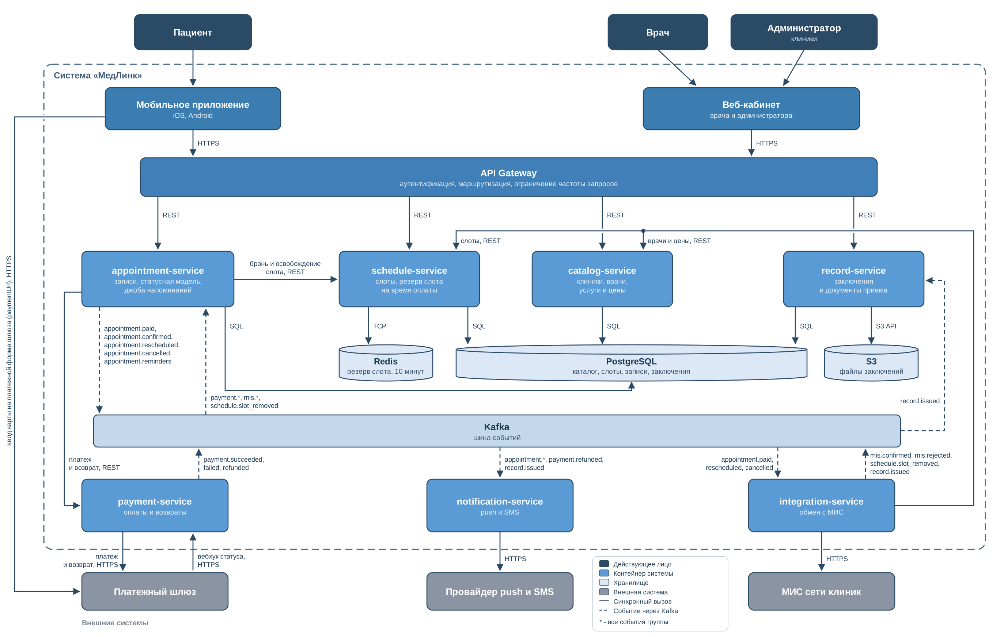
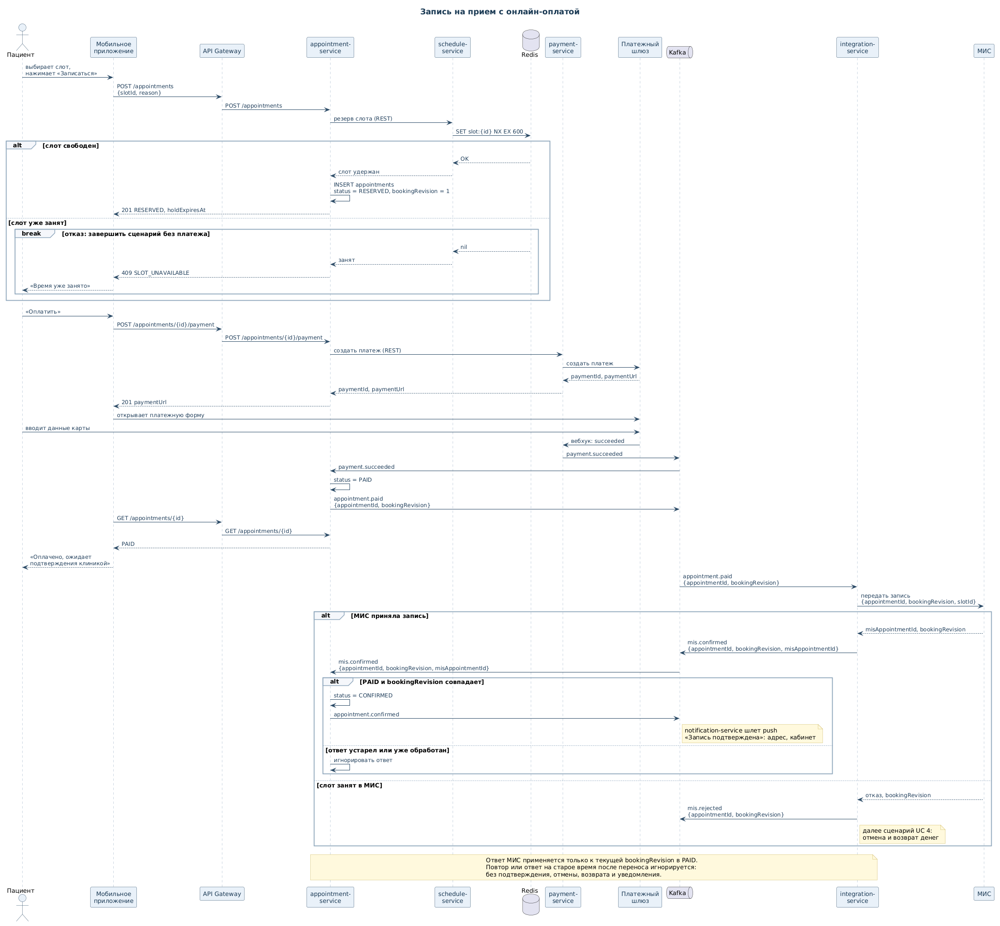
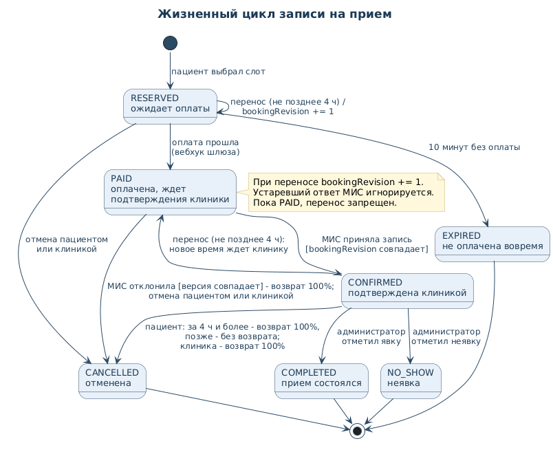
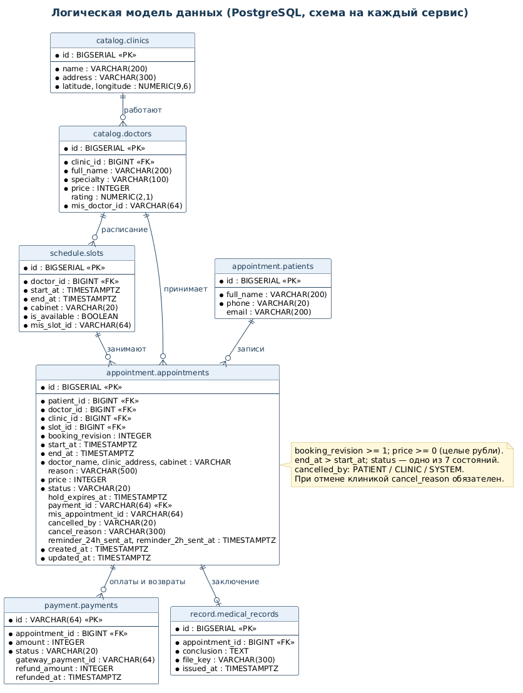
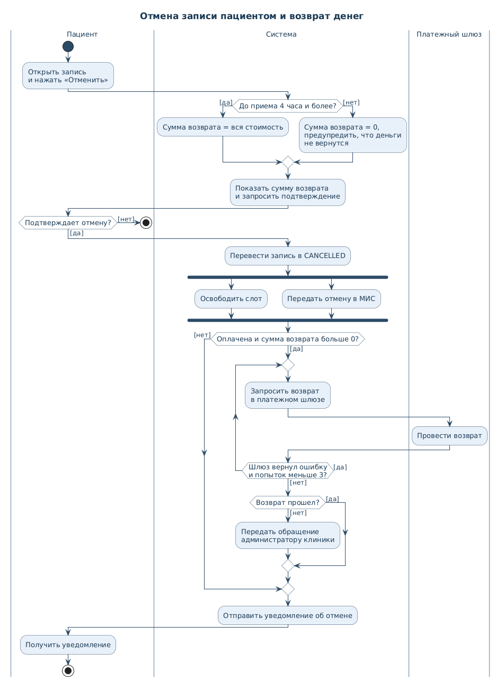
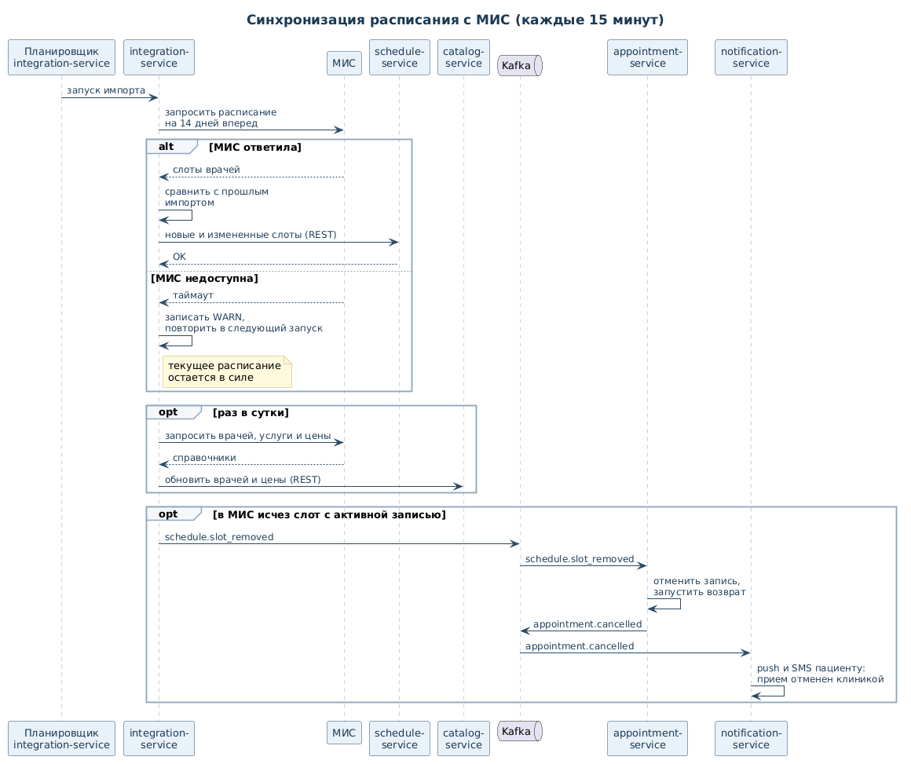
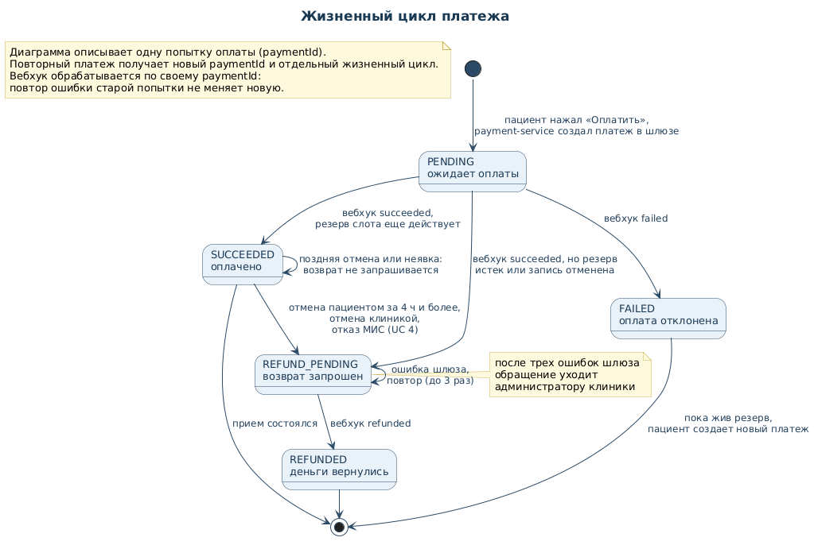

# МедЛинк: итоговый отчет

Учебный проект по курсу «Системный анализ и разработка сложных информационных систем». Команда: Благинин Александр, Варвара Малинина, Божик Максим, Тихомиров Никита.

МедЛинк помогает пациенту найти врача, записаться с предоплатой, управлять записью и читать заключения. Врач готовится к приемам, администратор управляет посещениями. Главная задача анализа — согласовать приложение, медицинскую информационную систему (МИС) и платежный шлюз: оплата еще не означает подтверждения клиники.

Работа включает **целевой проект** и **учебный API**. Семь сервисов, инфраструктура и фоновые задания описывают будущую систему. Прототип — единое приложение FastAPI с данными в памяти и заглушками интеграций.

## 1. Концепция и требования

### 1.1. Пользовательские истории

| ID | История и проверяемый результат |
|---|---|
| US 1 | Как пациент, хочу найти врача по специальности, клинике рядом, цене и свободной дате, чтобы выбрать прием без звонка. Местоположение задается координатами телефона или введенным адресом; преобразование адреса в координаты относится к клиентскому сценарию, отдельного API геокодирования нет. |
| US 2 | Как пациент, хочу выбрать слот, указать причину обращения и оплатить картой, чтобы прийти к врачу без оформления оплаты в регистратуре. После платежа вижу ожидание подтверждения клиникой, затем результат МИС. |
| US 3 | Как пациент, хочу получить напоминания за сутки и за два часа с адресом и кабинетом, чтобы не пропустить визит. Для поздно созданной записи действуют правила пропуска устаревших напоминаний из ТЗ. |
| US 4 | Как пациент, хочу перенести оплаченный прием на свободное время того же врача не позднее чем за четыре часа, чтобы сохранить оплату. Новое время снова подтверждает МИС. |
| US 5 | Как пациент, хочу отменить запись и до подтверждения видеть сумму возврата, чтобы понимать последствия. При отмене за четыре часа и раньше возвращается 100%, при более поздней отмене до приема — 0%. |
| US 6 | Как пациент, хочу видеть историю визитов и заключения врачей, чтобы пользоваться результатами без бумажных выписок. Доступны только собственные данные. |
| US 7 | Как врач, хочу видеть своих пациентов на день, причины обращения и их прошлые заключения по сети, чтобы подготовиться к приемам. Право на медицинские данные требует связи пациента с этим врачом. |
| US 8 | Как администратор клиники, хочу видеть записи и оплату за день и отмечать явку, чтобы контролировать загрузку. Причины обращения и медицинские заключения мне недоступны. |
| US 9 | Как администратор, хочу отменить прием по причине болезни врача или изменения графика, чтобы пациент получил причину отмены, полный возврат и варианты нового времени. Новую запись выбирает пациент. |

Предоплата выбрана как продуктовая гипотеза: она позволяет завершить оформление до визита и может уменьшить число необязательных броней. Снижение неявок в проекте не измерялось. Оплата в клинике и ДМС остаются вне текущего объема.

### 1.2. Состояния и бизнес-правила

| Запись | Значение |
|---|---|
| `RESERVED` | Слот зарезервирован на 10 минут, ожидается оплата. |
| `PAID` | Оплата подтверждена, ожидается решение МИС; также используется после переноса оплаченной записи. |
| `CONFIRMED` | МИС приняла текущую версию записи. |
| `CANCELLED` | Запись отменена пациентом, клиникой или системой; инициатор и причина сохраняются. |
| `EXPIRED` | Срок неоплаченного резерва истек. |
| `COMPLETED` | Администратор отметил состоявшийся визит. |
| `NO_SHOW` | Администратор отметил неявку. |

Платеж имеет независимое состояние: `PENDING → SUCCEEDED / FAILED`, затем при возврате `SUCCEEDED → REFUND_PENDING → REFUNDED`. Отмена записи не означает, что деньги уже поступили пациенту: это подтверждается отдельно платежным событием. После неудачной оплаты новый платеж разрешен, пока действует резерв.

| Событие | Запись и слот | Денежное последствие |
|---|---|---|
| Перенос подтвержденной оплаченной записи при `startAt − now ≥ 4 ч` | Новый слот того же врача, старая бронь освобождена, статус `PAID` | Существующая оплата переносится, повторного списания нет. |
| Перенос неоплаченного резерва при той же границе | Новый слот того же врача, старая бронь освобождена, статус остается `RESERVED`, срок резерва не продлевается | Платеж не считается оплаченным; действующая попытка оплаты сохраняется. |
| Перенос позднее границы | Отказ, старая запись сохраняется | Без изменений. |
| Отмена пациентом при `startAt − now ≥ 4 ч` | `CANCELLED`, слот освобожден | Полный возврат запрашивается у шлюза. |
| Поздняя отмена до начала / неявка | `CANCELLED` / `NO_SHOW` | Возврата нет. |
| Отмена клиникой | `CANCELLED`, причина обязательна | Возврат 100% независимо от четырехчасовой границы. |
| МИС отклонила оплаченный слот | `CANCELLED`; конфликтный слот не возвращается в продажу | Возврат 100%, предложение другого времени. |
| Деньги пришли после истечения резерва | `EXPIRED`, запись не подтверждается | Запрашивается полный возврат. |

Граница **ровно четыре часа включена** в разрешенный перенос и полный возврат. Перенос по инициативе клиники оформляется как отмена с возвратом; новое время пациент выбирает и оплачивает отдельно. Уведомление о возврате должно различать «возврат запрошен» и «возврат подтвержден»; срок зачисления зависит от платежного провайдера.

### 1.3. Доступ

| Субъект | Разрешено | Ограничение |
|---|---|---|
| Пациент | Каталог, собственные записи, оплата, перенос, отмена, собственные заключения | Нельзя читать чужую запись по ее ID. |
| Врач | Свои приемы; причины обращения и прошлые заключения связанных пациентов | В прототипе заключения доступны при подтвержденной записи к этому врачу на текущую или будущую дату. |
| Администратор | Записи своей клиники, состояния оплаты, явка и отмена | Медицинские поля скрыты во всех ответах, включая ответы операций изменения. |
| Платежный шлюз / МИС | Только соответствующий интеграционный callback | Нужна проверка источника и корреляция с конкретной операцией. |

В прототипе роли задают публичные тестовые токены. Это демонстрация разграничения, а не промышленная аутентификация; реальные медицинские данные в него не загружаются.

## 2. Целевая архитектура

**Тип/нотация:** C4, обзор контейнеров и внешних систем. **Назначение:** показать ответственность компонентов и взаимодействия. Схема объединяет приложения, сервисы и инфраструктуру; семь backend-сервисов — логические компоненты проекта, не развернутые процессы прототипа.

| Компонент backend | Ответственность | Истории |
|---|---|---|
| `catalog-service` | Врачи, специальности, клиники, услуги и цены | US 1 |
| `schedule-service` | Свободные слоты и временный резерв | US 1, US 2, US 4, US 5 |
| `appointment-service` | Жизненный цикл записи, правила изменений, явка, запуск напоминаний | US 2–US 5, US 7–US 9 |
| `payment-service` | Создание платежа, обработка результатов, запрос возврата | US 2, US 5, US 9 |
| `notification-service` | Доставка push/SMS, обработка повторов событий | US 3–US 5, US 9 |
| `record-service` | История посещений и медицинские заключения | US 6, US 7 |
| `integration-service` | Обмен расписанием, записями и заключениями с МИС | US 1, US 2, US 4–US 7, US 9 |

Мобильное приложение и рабочий веб-кабинет обращаются через API Gateway; это отдельные клиенты и входная точка. PostgreSQL хранит долговременные данные, Redis предполагается для короткого резерва, S3 — для файлов заключений, Kafka — для событий. МИС, платежный шлюз и провайдер уведомлений находятся вне границ МедЛинк.

Сервис записи резервирует слот и инициирует платеж. Приложение открывает `paymentUrl` шлюза; данные карты не проходят через МедЛинк. Подтверждение приходит вебхуком шлюза. После оплаты запись получает `PAID`; ответ МИС для актуальной версии переводит ее в `CONFIRMED`.

| Событие целевого проекта | Издатель → потребитель | Смысл |
|---|---|---|
| `payment.succeeded` | payment → appointment | Перевести запись в ожидание МИС. |
| `appointment.paid`, `appointment.rescheduled` | appointment → integration | Передать новую запись или перенос в МИС. |
| `appointment.confirmed` | appointment → notification | Сообщить о подтверждении клиникой. |
| `appointment.cancelled` | appointment → integration, notification; payment при возврате | Синхронизировать отмену, уведомить пациента, выполнить денежную компенсацию. |
| `appointment.reminder` | appointment → notification | Доставить конкретное напоминание. |
| `schedule.slot_removed` | integration → appointment | Обработать исчезновение занятого слота из МИС. |
| `record.created` | integration → record | Сохранить новое заключение. |

События — проектный контракт. Асинхронность требует повторов, дедупликации и компенсаций; общей транзакции с МИС и банком нет. Внутренний резерв не исключает запись через регистратуру, поэтому нужен UC 4. Периодический импорт также не дает мгновенной согласованности.

Для дальнейшей реализации нужны атомарное занятие слота, транзакционная фиксация событий (outbox), идемпотентные потребители и устойчивое хранилище. Kafka и Redis прототипом не используются.

## 3. Техническое задание на backend

### 3.1. Задание `AppointmentReminderJob`

**Назначение:** сформировать напоминания только о подтвержденных приемах. Владелец — `appointment-service`, получатель — `notification-service`. Это спецификация будущей реализации; фоновой джобы и отправки SMS/push в учебном API нет.

| Параметр | Значение / назначение |
|---|---|
| `ReminderJobInterval` | Запуск каждые 5 минут. |
| `ReminderOffsets` | 24 часа и 2 часа до начала. |
| `ReminderBatchSize` | Не более 500 записей на выборку каждого типа; необработанные остаются следующему запуску. |
| `ReminderLateLimit` | 60 минут: более позднее двухчасовое напоминание пропускается. |
| `ReminderTopic` | `appointment.reminders.v1`. |
| Время | Хранение и сравнение в UTC; местное время клиники используется при отображении. |

Алгоритм одного запуска:

1. Зафиксировать `now` в UTC. Для каждого offset выбрать необработанные `CONFIRMED` с `now < start_at ≤ now + offset`; сортировать по времени и ID, ограничить партию.
2. Повторно проверить статус и `booking_revision` на случай отмены/переноса. Атомарно резервировать задачу, исключив одновременную обработку двумя исполнителями.
3. Для типа `24h`, если осталось менее трех часов, записать результат `SKIPPED_LATE`: два напоминания подряд не нужны. Для типа `2h`, если осталось менее 60 минут, также пропустить, зафиксировать `REMINDER_TOO_LATE`.
4. Для остальных сформировать `eventId = appointmentId:bookingRevision:reminderType`, ключ партиции — `appointmentId`. В событие включить `occurredAt`, `appointmentId`, `bookingRevision`, `patientId`, `reminderType`, `startAt`, имя врача, адрес клиники и кабинет. Медицинские заключения и причина обращения не передаются.
5. Записать событие в outbox в одной транзакции с результатом обработки. Издатель отправляет его в Kafka, повторяя неудачные публикации; возможны транспортные дубли.
6. `notification-service` проверяет актуальность версии/состояния и дедуплицирует по `eventId`. После переноса новая версия допускает новые напоминания.
7. Записать счетчики задач, задержку и ошибки без медицинского текста. Сбой хранилища завершает запуск ошибкой; сбой брокера не удаляет outbox.

Публикация не означает доставку. Исходные `*_sent_at` смешивали отправку и пропуск; нужны отдельные результат обработки и подтверждение доставки. Без поддержки провайдера нельзя гарантировать ровно одно SMS при любом сбое.

Критерии будущих тестов: `CONFIRMED` в окне создает событие; `PAID`/отмена — нет; повтор запуска не создает новое логическое событие; перенос меняет ключ; ровно 60 минут допускают отправку; сбой брокера не теряет задачу; пропуск отличается от доставки.

### 3.2. Логическая сущность `appointments`

| Поле / группа | Тип и ограничение | Назначение |
|---|---|---|
| `id` | bigint, PK | Идентификатор записи. |
| `patient_id`, `doctor_id`, `clinic_id`, `slot_id` | bigint, FK, NOT NULL | Связи с пациентом, врачом, клиникой и текущим слотом. |
| `booking_revision` | integer ≥ 1, NOT NULL | Версия бронирования; увеличивается при переносе. |
| `start_at`, `end_at` | timestamptz, NOT NULL, `end_at > start_at` | Время приема в UTC. |
| `doctor_name`, `clinic_address`, `cabinet` | строки, NOT NULL | Снимок данных приема для отображения и уведомлений. |
| `status` | enum, NOT NULL | Одно из семи состояний записи. |
| `reason` | varchar(500), nullable | Необязательная причина обращения; доступна пациенту и связанному врачу. |
| `price` | integer ≥ 0, NOT NULL | Зафиксированная стоимость в целых рублях; деньги не хранятся как float. |
| `hold_expires_at` | timestamptz, nullable | Срок резерва, применим к `RESERVED`. |
| `payment_id` | varchar(64), nullable, логическая FK | Текущая попытка оплаты; предыдущие попытки сохраняются отдельно. |
| `mis_appointment_id` | varchar(64), nullable | Идентификатор подтвержденной записи в МИС. |
| `cancelled_by`, `cancel_reason` | enum / строка, nullable | Инициатор и причина отмены; для клиники причина обязательна. |
| `reminder_24h_sent_at`, `reminder_2h_sent_at` | timestamptz, nullable | Поля исходной модели; проектное уточнение требует отдельного учета результата и версии напоминания. |
| `created_at`, `updated_at` | timestamptz, NOT NULL | Аудит изменения. |

Платежи, их попытки и заключения — отдельные сущности. Нужны индексы по статусу/времени, пациенту и врачу; занятие слота обеспечивается транзакционно. Это логическая модель PostgreSQL; миграций в прототипе нет.

## 4. Сценарии использования

Сценарии описывают целевую систему и внешних акторов; ограничения прототипа приведены в разделе 6.

### UC 1. Запись с онлайн-оплатой

**Истории:** US 1, US 2. **Акторы:** пациент, платежный шлюз, МИС. **Предусловия:** пациент определен системой, врач и свободный слот найдены. **Успех:** оплаченная запись подтверждена МИС для актуальной версии.

1. Пациент выбирает свободный слот и вводит причину обращения.
2. МедЛинк проверяет доступность и атомарно резервирует слот на 10 минут, создает `RESERVED` с `bookingRevision = 1`.
3. Пациент подтверждает стоимость и выбирает оплату картой.
4. МедЛинк создает платеж и передает пациенту ссылку на форму шлюза.
5. Пациент оплачивает на стороне шлюза; шлюз присылает подтверждение в МедЛинк.
6. МедЛинк проверяет платеж и срок резерва, переводит платеж в `SUCCEEDED`, запись в `PAID`, передает запись и ее версию в МИС.
7. МИС принимает слот и возвращает результат для той же версии бронирования.
8. МедЛинк переводит запись в `CONFIRMED`; пациент видит подтвержденные время и клинику.

**Альтернативы:** 2а — слот уже занят: ответ о конфликте, обновление списка без списания денег. 5а — платеж отклонен: новая попытка возможна в пределах резерва. 6а — подтверждение оплаты пришло после истечения резерва: запись не подтверждается, запускается полный возврат. 7а — отказ МИС: UC 4. 7б — МИС недоступна: запись остается `PAID`; в целевом проекте повторы и ручная проверка после 30 минут, а не ложное подтверждение.

### UC 2. Перенос оплаченного приема

**История:** US 4. **Акторы:** пациент, МИС. **Предусловия:** своя оплаченная подтвержденная запись, до начала не менее четырех часов. **Успех:** новое время подтверждено, повторного списания нет.

1. Пациент открывает запись и выбирает перенос.
2. МедЛинк проверяет владельца, состояние и границу `startAt − now ≥ 4 ч`.
3. МедЛинк показывает свободные слоты того же врача.
4. Пациент выбирает и подтверждает новое время.
5. МедЛинк занимает новый слот, освобождает старый, увеличивает `bookingRevision`, сохраняет оплату и переводит запись в `PAID`.
6. МедЛинк отправляет перенос в МИС с новой версией бронирования.
7. МИС принимает перенос и возвращает результат для этой версии.
8. МедЛинк возвращает `CONFIRMED`, показывает новое время и планирует актуальные напоминания.

**Альтернативы:** 2а — поздно или состояние недопустимо: отказ без изменения исходной записи. 3а — слотов нет: пациент сохраняет запись либо отдельно запускает отмену. 5а — новый слот занят конкурентно: старый остается за пациентом, список обновляется. 7а — отказ МИС: отмена с полным возвратом по UC 4. 7б — пришел запоздалый callback старой версии: подтверждение получения без изменения новой записи. 7в — МИС недоступна: ожидание и проектная процедура повторов.

### UC 3. Отмена пациентом с возвратом

**История:** US 5. **Акторы:** пациент, платежный шлюз, МИС. **Предусловия:** активная собственная оплаченная запись до начала. **Успех основного потока:** запись отменена, возврат подтвержден шлюзом.

1. Пациент выбирает отмену записи.
2. МедЛинк вычисляет время до приема и показывает возвращаемую сумму: 100% при границе не менее четырех часов.
3. Пациент подтверждает отмену с показанной суммой.
4. МедЛинк повторно проверяет условия, сохраняет `CANCELLED` и освобождает слот.
5. МедЛинк передает отмену в МИС и запрашивает полный возврат у шлюза; платеж получает `REFUND_PENDING`.
6. Платежный шлюз выполняет возврат и сообщает результат.
7. МедЛинк сохраняет `REFUNDED`, сообщает пациенту об отмене и подтверждении возврата.

**Альтернативы:** 3а — пациент передумал: изменений нет. 4а — после просмотра суммы пересечена четырехчасовая граница: требуется повторное подтверждение новых условий, молчаливого изменения суммы быть не должно; это требование клиентского сценария, не отдельный endpoint расчета. 5а — поздняя отмена: после предупреждения возврат не запрашивается, платеж остается `SUCCEEDED`. 6а — ошибка шлюза: отмена сохраняется, возврат ожидает повторов; в проекте после трех ошибок обращение передается администратору. Сбой МИС не восстанавливает уже отмененную запись; синхронизация повторяется.

### UC 4. МИС отклонила оплаченный слот

**Истории:** US 2, US 5. **Акторы:** МИС, платежный шлюз, пациент. **Предусловия:** запись `PAID`; регистратура заняла слот непосредственно в МИС. **Успех:** конфликтная запись отменена, возврат подтвержден, пациент получил варианты продолжения.

1. МедЛинк передает МИС оплаченную запись с идентификатором и актуальной версией.
2. МИС отклоняет ее с причиной занятости слота.
3. МедЛинк проверяет версию ответа, сохраняет отмену системой и причину; конфликтный слот не публикуется как свободный.
4. МедЛинк запрашивает у шлюза полный возврат независимо от времени до приема.
5. Шлюз сообщает о выполнении возврата; МедЛинк сохраняет `REFUNDED`.
6. МедЛинк сообщает пациенту причину отмены и предлагает ближайшие доступные слоты того же врача.
7. Пациент выбирает предложенное время или отказывается от новой записи.
8. При согласии МедЛинк начинает новую запись по UC 1; предыдущий возврат не считается оплатой нового приема.

**Альтернативы:** 2а — МИС не отвечает: это ожидание, а не отказ; запись остается `PAID`, применяется процедура повторов/ручной проверки. 3а — ответ относится к старой версии после переноса: он игнорируется для изменения состояния. 5а — возврат еще не подтвержден: пациент видит ожидаемый возврат, а не сообщение о зачисленных деньгах. 6а — у врача нет слотов: предлагаются врачи той же специальности. 7а — отказ пациента завершает сценарий без новой записи.

## 5. Диаграммы поведения и данных

Архитектуру дополняют шесть диаграмм четырех типов. Они описывают целевую систему; [исходники PlantUML](diagrams/) находятся рядом с изображениями.

### 5.1. Запись и оплата

**Тип/нотация:** UML sequence, PlantUML. **Назначение:** раскрыть UC 1: резерв, платежная форма, вебхук и подтверждение МИС; отделить действие пациента от доверенного результата шлюза.

### 5.2. Жизненный цикл записи

**Тип/нотация:** UML state machine, PlantUML. **Назначение:** зафиксировать семь состояний записи и переходы, включая `PAID`, перенос и отмену; подтверждение относится к текущей версии.

### 5.3. Логическая модель данных

**Тип/нотация:** ERD с кардинальностями crow’s foot, PlantUML. **Назначение:** связать клиники, врачей, слоты, пациентов, записи, платежи и заключения. Это логическая модель; физический учет напоминаний/outbox еще требует детализации.

### 5.4. Отмена и возврат

**Тип/нотация:** UML activity, PlantUML. **Назначение:** показать отмену и развилку полного/нулевого возврата по четырехчасовой границе; отделить отмену от ожидания банковского возврата.

### 5.5. Синхронизация с МИС

**Тип/нотация:** UML sequence, PlantUML. **Назначение:** показать импорт расписания каждые 15 минут на 14 дней, ежедневное обновление справочников и исчезновение занятого слота. Это проектный обмен; прототип демонстрирует только callback бронирования.

### 5.6. Жизненный цикл платежа

**Тип/нотация:** UML state machine, PlantUML. **Назначение:** различить списание, запрос возврата и подтвержденный возврат; проверить UC 3/UC 4 независимо от состояния записи.

## 6. API и проверка

### 6.1. Исполняемый объем

[Код FastAPI](../api/main.py), [инструкция](../api/README.md), [OpenAPI](../api/openapi.yaml), [Postman](../api/medlink.postman_collection.json), [тесты](../api/test_api.py). В [интерактивном Swagger](https://mbozhik.github.io/medlink/) тот же FastAPI исполняется через Pyodide/ASGI в браузере; это исполнение внутри вкладки, а не постоянно работающий backend. Данные сбрасываются при перезапуске. Платежи, решения МИС и заключения демонстрационные; списаний, возвратов на карту, SMS/push и импорта нет.

Все пути ниже имеют префикс `/api/v1`; корневая служебная страница в число операций не включена.

| № | Метод и путь | Операция / связь |
|---|---|---|
| 1 | `GET /doctors` | Поиск врача, фильтры и расстояние; US 1. |
| 2 | `GET /doctors/{doctorId}/slots` | Слоты врача; US 1. |
| 3 | `POST /appointments` | Резерв и причина обращения; US 2, UC 1. |
| 4 | `GET /appointments/{appointmentId}` | Детали записи с проверкой доступа; US 2. |
| 5 | `PATCH /appointments/{appointmentId}` | Перенос с увеличением версии; US 4, UC 2. |
| 6 | `DELETE /appointments/{appointmentId}` | Отмена пациентом/клиникой; US 5, US 9, UC 3. |
| 7 | `POST /appointments/{appointmentId}/payment` | Создание платежа и ссылки; US 2, UC 1. |
| 8 | `POST /payments/webhook` | Результат оплаты/возврата; UC 1, UC 3, UC 4. |
| 9 | `GET /patients/me/appointments` | Собственная история и заключения; US 6. |
| 10 | `GET /clinics/{clinicId}/appointments` | Приемы для врача/администратора с фильтрацией; US 7, US 8. |
| 11 | `PATCH /appointments/{appointmentId}/attendance` | Явка/неявка; US 8. |
| 12 | `GET /patients/{patientId}/records` | Заключения связанного пациента для врача; US 7. |
| 13 | `POST /integrations/mis/booking-result` | Решение МИС по версии бронирования; UC 1, UC 4. |

Итого **13 операций и четыре HTTP-метода: GET, POST, PATCH, DELETE**. API покрывает выбранные операции историй, но не весь их пользовательский путь: например, автоматические напоминания US 3 и подбор альтернатив после отмены пока проектируются.

Полный контракт параметров, тел, ответов и кодов ошибок задан OpenAPI. Создание записи/платежа возвращает `201`; ошибки доступа, отсутствия ресурса, конфликта состояния и валидации различаются. Для callback МИС обязательны `appointmentId`, `bookingRevision`, `result`; `misAppointmentId` необязателен. Начальная версия равна 1, при переносе увеличивается. Ответ старой версии подтверждается на транспортном уровне, но не может подтвердить или отклонить новый слот. Это корреляция операции, а не гарантия устойчивости после перезапуска.

### 6.2. Воспроизводимая проверка и ограничения

Из каталога `API`: `python -m pytest -q`. Для Postman: `baseUrl = http://127.0.0.1:8000`, полный прогон — с чистого сервера. Запуск и токены — в инструкции, ручная проверка — через Swagger UI `/docs`.

Проверено **19 автотестов**, а также **26 запросов / 40 проверок Newman без ошибок**: переходы записи/платежа, доступ, устаревшие версии и повторы платежных попыток. Это не проверка внешних провайдеров, устойчивости и многопроцессной конкуренции. Ссылки `.example` — заглушки оплаты и файлов заключений.

Токены из инструкции публичны. Промышленные аутентификация, защита данных и восстановление не реализованы. Идемпотентность проверена для конкретных повторов; постоянного журнала событий нет.

## 7. Рефлексия и индивидуальный вклад

### 7.1. Что изменилось и почему

| Обнаруженная проблема | Изменение / результат |
|---|---|
| Врач должен читать причину обращения, но пациент ее не вводил | Поле `reason` добавлено в US 2, UC 1 и создание записи. |
| Перенос смешивался с отменой и возвратом | Разделены US 4/US 5; определены граница четырех часов и денежные последствия. |
| Неясен источник «рядом со мной» | Указаны координаты и ручной ввод адреса; API поиска принимает координаты, но не выполняет геокодирование. |
| Не определен доступ к медицинским данным | Введена ролевая матрица; медицинские поля администратора исключаются также из ответов изменения записи. |
| Оплата ошибочно приравнивалась к подтверждению клиники | Введен `PAID`, описаны отказ МИС, компенсация и отдельные состояния платежа. |
| Неясны отмены со стороны клиники | US 9: обязательная причина и полный возврат; новое время выбирает пациент. |
| Непонятны путь на платежную форму и потребители событий | Добавлены внешняя форма, доверенный вебхук и направления событий целевой архитектуры. |
| Повтор ответа МИС после переноса мог подтвердить другое время | Добавлена `bookingRevision`; задержанный ответ старой версии не меняет новую запись, поведение покрыто регрессионными тестами. |
| Повтор ошибки старой платежной попытки мог повлиять на новую | Callback сопоставляется с конкретным `paymentId`; добавлена регрессионная проверка. |
| Идентификатор напоминания не различал переносы, отметка «отправлено» включала пропуск | В ТЗ уточнены версия в ключе события и отдельный результат обработки. Реализация джобы остается будущей работой. |

В требованиях резерв, оплата и подтверждение клиники описаны как отдельные этапы. При отказе МИС предусматриваются отмена записи и возврат. Учебное приложение позволяет проверить контракт без развертывания семи сервисов.

Далее нужны транзакционное хранилище, события и повторы; пока остаются потеря состояния при рестарте, конкуренция слотов и отсутствие уведомлений. Пользу предоплаты следует проверить измерением неявок и интервью с клиникой.

### 7.2. Вклад участников

| Участник | Вклад |
|---|---|
| Благинин Александр | Концепция системы и схема C4, таблица событий и доработка архитектуры по рецензии; UC 4 и диаграмма синхронизации с МИС; операция API 13; сборка отчета и рефлексия. |
| Божик Максим | US 4, US 5 и US 9; UC 2 и UC 3; правила возврата, диаграммы состояний записи и отмены; операции API 5 и 6; итоговая проверка и согласование API, тестов и документации, исправление повторных событий МИС и оплаты; подготовка Wiki и интерактивного Swagger, публикация и проверка ссылок. |
| Тихомиров Никита | US 1, US 6–US 8 и ролевая модель; ТЗ на напоминания и сущность `appointments`, ERD; описание методов каталога, истории визитов и рабочих мест. |
| Варвара Малинина | US 2 и US 3, UC 1; описание сценария записи и оплаты, состояния платежа. |

## 8. Структура и покрытие проекта

| Требование | Где представлено | Результат |
|---|---|---|
| Улучшенная концепция и пользовательские истории | Раздел 1 | 9 историй, правила, роли, границы продукта. |
| Архитектурная схема | Раздел 2 | 7 сервисов, C4-обзор, внешние системы и события. |
| ТЗ хотя бы на один аспект backend | Раздел 3 | Подробная джоба; дополнительно логическая сущность записи. |
| 4 UC, каждый ≥ 2 внешних акторов и ≥ 6 шагов | Раздел 4 | 4 сценария по 7–8 шагов, предусловия, результаты и альтернативы. |
| ≥ 5 дополнительных диаграмм, ≥ 2 типов | Раздел 5 | 6 диаграмм, 4 типа; C4 учитывается отдельно. |
| ≥ 9 операций, 4 HTTP-метода | Раздел 6, OpenAPI и код | 13 операций; GET/POST/PATCH/DELETE. |
| Документация и демонстрация запросов | Инструкция API, OpenAPI, Postman, тесты | Воспроизводимая локальная проверка с заглушками интеграций. |
| Рефлексия, изменения после рецензии, вклад | Раздел 7 | Изменения привязаны к проблемам; индивидуальный вклад указан в таблице. |
